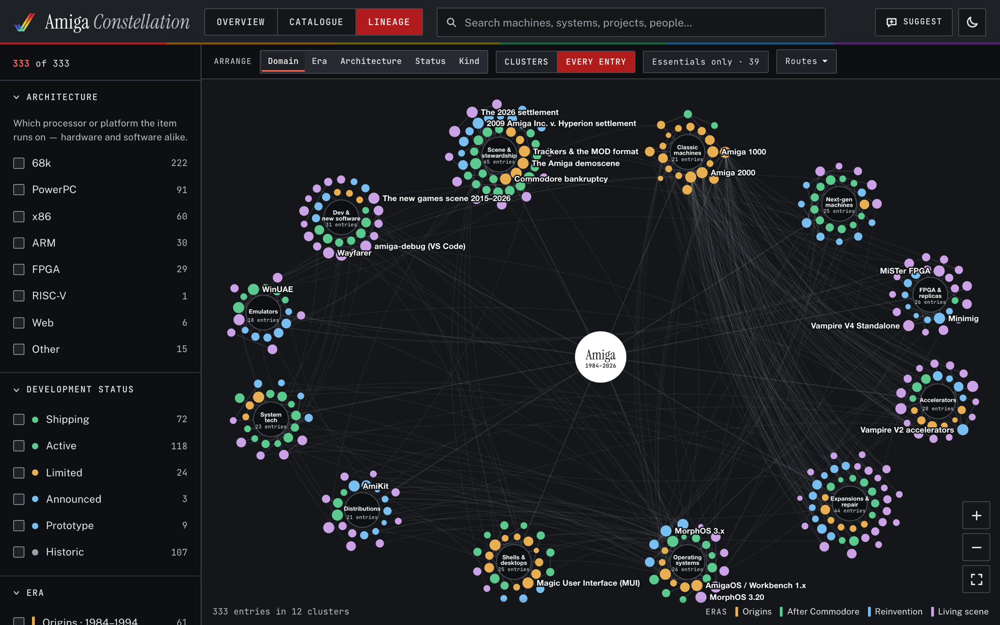
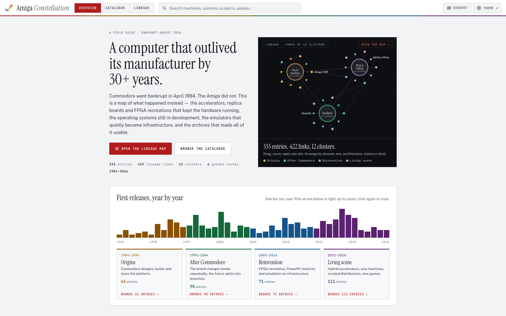
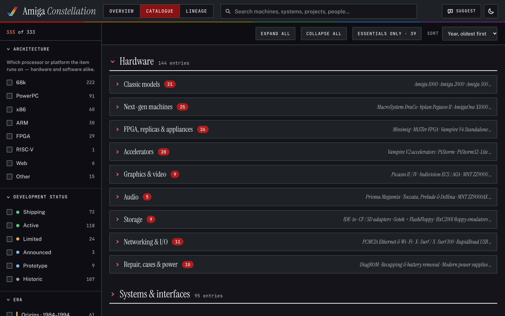
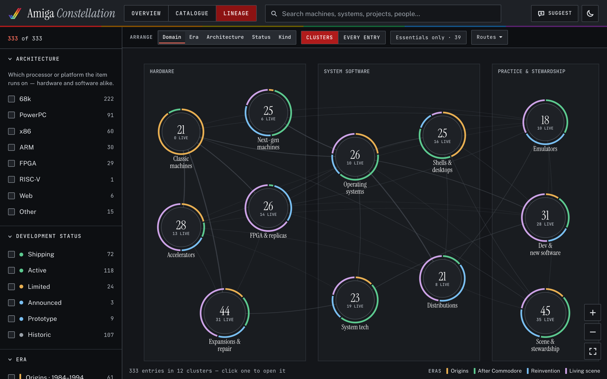
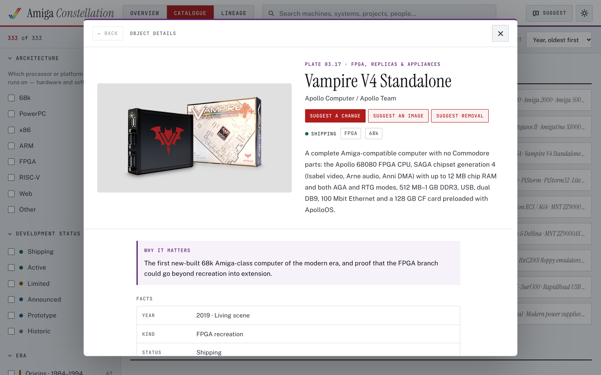
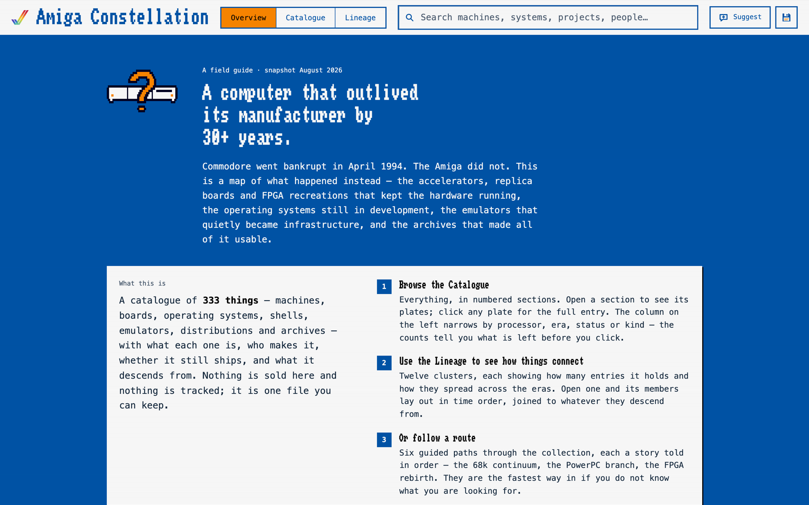
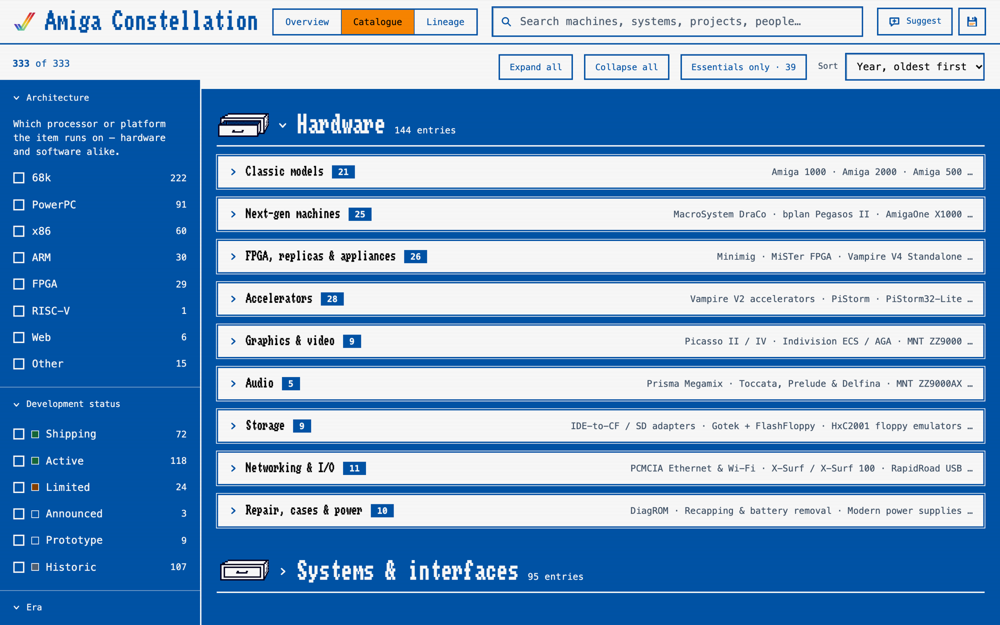
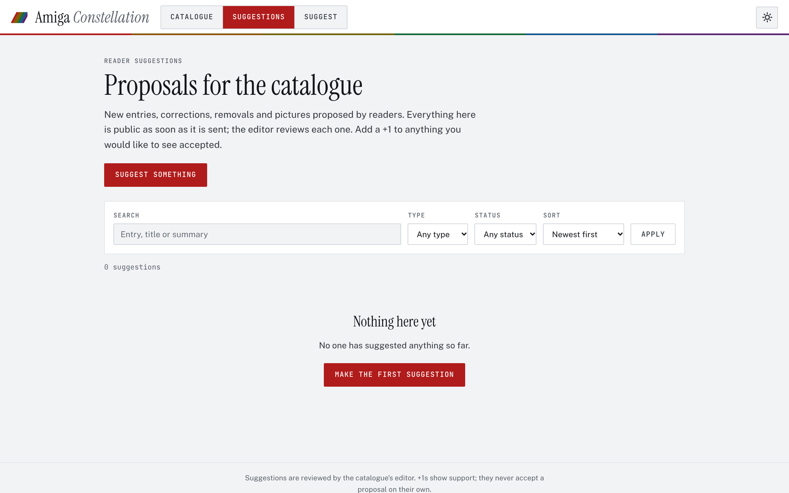
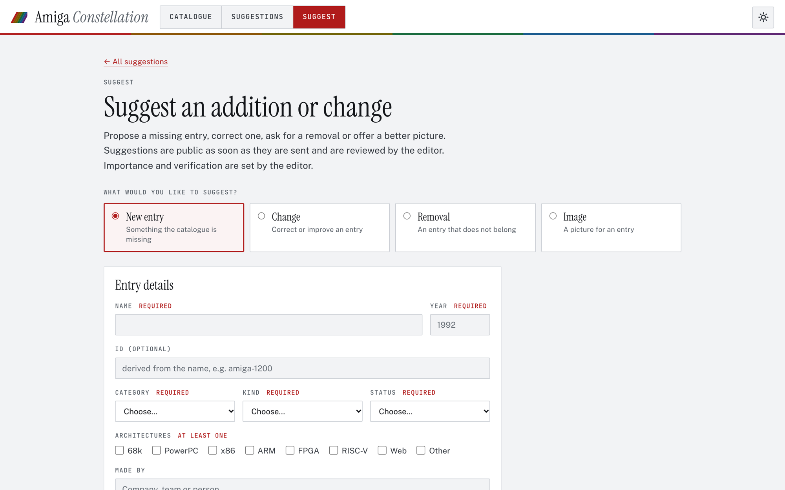

<p align="center">
  <a href="https://amiga.kexperiments.com">
    
  </a>
</p>

<h1 align="center">Amiga Constellation</h1>

<p align="center">
  <em>A field guide to the computer that outlived its manufacturer by 30+ years.</em><br>
  333 entries · 422 lineage links · 1984–2026 · one Go binary, one SQLite file
</p>

<p align="center">
  <a href="https://github.com/KaanEmec/Amiga-Ecosystem/releases"></a>
  
  
  
  <a href="LICENSE"></a>
</p>

<br>

<h2 align="center">🌐 &nbsp;<a href="https://amiga.kexperiments.com">amiga.kexperiments.com</a></h2>
<p align="center"><strong>The live catalogue.</strong> Nothing is sold, nothing is tracked, no account needed.</p>

<h2 align="center">💬 &nbsp;<a href="https://amiga.kexperiments.com/suggestions">amiga.kexperiments.com/suggestions</a></h2>
<p align="center">
  <strong>Spotted a mistake, a missing machine, or a better picture?</strong><br>
  Propose a new entry, a change, a removal or an image — no sign-up — and +1 the proposals you agree with.<br>
  Every suggestion is public the moment it is sent and is reviewed by the editor.
</p>

<p align="center">
  <a href="https://amiga.kexperiments.com"></a>
  &nbsp;
  <a href="https://amiga.kexperiments.com/suggestions/new"></a>
  &nbsp;
  <a href="https://amiga.kexperiments.com/suggestions"></a>
</p>

<br>

## What it is

Commodore went bankrupt in April 1994. The Amiga did not. This is a map of what happened
instead: the accelerators, replica boards and FPGA recreations that kept the hardware
running, the operating systems still in development, the emulators that quietly became
infrastructure, and the archives that made all of it usable.

Each of the 333 entries records what the thing is, who makes it, whether it still ships,
and what it descends from. The lineage links turn that into a graph you can walk.

### Three ways in

| | |
|:--|:--|
| **Overview** | The front page: a drawn slice of the map, first releases by year, the twelve cluster rings, selected objects with photographs, the six guided routes, and how to read it all. |
| **Catalogue** | Everything in numbered sections and plates, with a five-dimensional filter rail whose counts never offer an empty result. |
| **Lineage** | A canvas map with five arrangements (Domain, Era, Architecture, Status, Kind), cluster boards, and the full radial constellation. |

<table>
  <tr>
    <td width="50%"><a href="docs/screenshots/overview-light.png"></a></td>
    <td width="50%"><a href="docs/screenshots/catalog-dark.png"></a></td>
  </tr>
  <tr>
    <td align="center"><sub><b>Overview</b> · Museum Light</sub></td>
    <td align="center"><sub><b>Catalogue</b> · Museum Dark</sub></td>
  </tr>
  <tr>
    <td width="50%"><a href="docs/screenshots/lineage-dark.png"></a></td>
    <td width="50%"><a href="docs/screenshots/detail-light.png"></a></td>
  </tr>
  <tr>
    <td align="center"><sub><b>Lineage</b> · Clusters, Domain arrangement</sub></td>
    <td align="center"><sub><b>Entry dialog</b> · with the three suggestion actions</sub></td>
  </tr>
</table>

### Three themes

Museum Light and Museum Dark are the editorial pair. **Workbench Mode** redraws the whole
site in Amiga Workbench 1.3: the four-colour palette, Topaz, interlace, and the original
drawer and tool icons. The picker is the sun/moon button in the header.

<table>
  <tr>
    <td width="50%"><a href="docs/screenshots/workbench.png"></a></td>
    <td width="50%"><a href="docs/screenshots/workbench-catalog.png"></a></td>
  </tr>
  <tr>
    <td align="center"><sub><b>Workbench Mode</b> · Overview</sub></td>
    <td align="center"><sub><b>Workbench Mode</b> · Catalogue</sub></td>
  </tr>
</table>

<br>

## Suggestions and review

> **Readers:** [amiga.kexperiments.com/suggestions](https://amiga.kexperiments.com/suggestions) lists every proposal with search,
> filters and newest/most-supported sorting. [Suggest something](https://amiga.kexperiments.com/suggestions/new) opens the form,
> or use the three buttons at the top of any entry dialog.

Visitors propose **new entries, changes, removals and images**. Valid proposals are public
immediately as *Pending* and can be +1'd once per browser while they wait. There is no
account; protection is Cloudflare Turnstile, a signed browser cookie, Origin checks,
honeypot and timing checks, and per-browser and per-IP limits.

The owner reviews the queue at `/admin/queue`: the current entry, the proposed differences
and a final preview, then **Accept**, **Edit & accept**, **Reject**, **Mark duplicate** or
**Hide spam**. Each acceptance is one transaction that updates the entry, records a revision
and a moderation entry, and freezes the proposal; a second click is refused. Suggested
images are fetched only when the owner asks, validated, and published as a local copy.
`/admin/stats` shows cookie-free visitor counts: no cookie, a daily-rotating hashed visitor id, nothing identifying stored.

<table>
  <tr>
    <td width="50%"><a href="docs/screenshots/suggestions.png"></a></td>
    <td width="50%"><a href="docs/screenshots/suggestions-new.png"></a></td>
  </tr>
  <tr>
    <td align="center"><sub><b>/suggestions</b> · public queue with +1 support</sub></td>
    <td align="center"><sub><b>/suggestions/new</b> · new entry, change, removal or image</sub></td>
  </tr>
</table>

<br>

## Run it locally

```bash
go run ./cmd/amiga serve
```

Opens on <http://127.0.0.1:8080>. On first start an empty database is created in
`./runtime/`, the seed (`data/amiga-data.json` and `images/`) is imported once, and a
development secret is generated. Turnstile is skipped in development when no keys are set.
Create the owner account, then sign in at `/admin/login`:

```bash
go run ./cmd/amiga owner init
```

SQLite is the live source of truth from then on; the JSON in `data/` is only the seed.

### Commands

| Command | What it does |
|---|---|
| `amiga serve` | start the server (`AMIGA_ADDR`, default `:8080`) |
| `amiga import [--replace] <file.json>` | validated import; without `--replace` only into an empty catalogue |
| `amiga export [file]` | the live catalogue as JSON, same shape as the seed |
| `amiga backup <dir>` | consistent database copy plus media |
| `amiga owner init\|reset-password\|reset-totp\|recovery-codes` | owner account and local recovery |

Configuration is environment-only; see [`deploy/amiga.env.example`](deploy/amiga.env.example).
Runtime data and secrets live in `AMIGA_DATA_DIR` and are git-ignored.

### Deploy

The live site runs the root [`Dockerfile`](Dockerfile) on Coolify, pinned to a release commit,
with a persistent volume at `/data` behind Cloudflare. A systemd layout, reverse-proxy configs
and a backup script are in [`deploy/`](deploy/README.md).

<br>

## Repository layout

| Path | What it is |
|---|---|
| `cmd/amiga`, `internal/` | the Go application (see [`ARCHITECTURE.md`](ARCHITECTURE.md)) |
| `web/static/js/*.js` | the catalogue UI as classic scripts: `data.js` boots, then core, catalog, detail, lineage, app, actions |
| `web/static/css/styles.css` | the design system, both Museum themes, plus admin and suggestion sections |
| `web/static/css/workbench.css` | Workbench Mode: Workbench 1.3 tokens, interlace overlay and component overrides |
| `web/templates/` | the page shell and the server-rendered suggestion and admin pages |
| `data/amiga-data.json` | seed content, read once; afterwards edit through `/admin` or `amiga import --replace` |
| `images/` | seed pictures, copied once into the runtime media directory |
| `tests/lineage-layout.cjs` | 40 layout scenarios for the lineage map |
| `deploy/` | Coolify notes, systemd unit, environment example, reverse-proxy configs, backup script |
| `docs/screenshots/` | the pictures in this README |
| [`DATA-README.md`](DATA-README.md) | the entry schema and editing rules |

<br>

<details>
<summary><b>How the catalogue is modelled</b></summary>
<br>

Everything is content, including the vocabularies. `meta` in the JSON defines the eras,
architectures, statuses, kinds and category groups; add a value there and it appears in the
filter rail automatically. Nothing about the taxonomy is hardcoded in the UI. Entries declare
`related` as their *ancestors*; children are derived at load, as is each entry's era from its
`year`. Filtering is five-dimensional, and each facet's counts are computed with its own
dimension released, so a facet never offers you a choice that would return nothing.

The three views are the front page (`renderOverview`), the catalogue accordion
(`renderCatalog`), and the canvas lineage map (`graphDraw`/`graphLayout`), which can be
arranged in five ways and carries the guided routes. Clusters uses circular summaries inside
rectangular regions; Every Entry keeps the radial constellation. Each entry belongs to one
cluster per arrangement. Architecture uses the first listed (primary) platform, while the
filter rail matches any supported platform. Small named clusters are retained rather than
merged.

The five visible Arrange buttons support click, Tab, arrow keys, Home and End. Changing
arrangement keeps search and facets, closes any open cluster board, and ends an active route.
Regions stack on narrow screens; dense Kind panels extend vertically rather than shrink their
text. Scroll or drag to explore Clusters, and use the zoom buttons or Ctrl+scroll to zoom.
Every Entry retains its scroll-to-zoom behavior.

The five Lineage arrangements are:

- **Domain:** Hardware, System software, and Practice & stewardship.
- **Era:** four panels in chronological order.
- **Architecture:** 68k & PowerPC, FPGA, and Host & other platforms.
- **Status:** Current (shipping, active, limited), Unreleased (planned, prototype), and Historic.
- **Kind:** Machines & components (original, replica, fpga, appliance, compatible, component,
  prototype); Software & environments (os, amigalike, oslike, emulator, shell, toolkit,
  launcher, tool, app); and People, preservation & ideas (archive, org, media, event, concept,
  other).

</details>

<details>
<summary><b>Reading an object</b></summary>
<br>

Objects in Overview, Catalogue, and Lineage open in a centered modal dialog. The page
underneath keeps its scroll position, filters, expanded sections, selection, and map camera.
On desktop the hero pairs the full image with the title and introduction; on narrow screens
it stacks them. Images keep their proportions, and missing images use the existing category
pictogram.

Related objects open in the same dialog. Its Back button restores the preceding object and
reading position; this history lasts until the dialog is closed. Close, Escape, or clicking
the backdrop returns focus to the originating object. During a guided route, reading related
objects leaves the current stop intact. Global keyboard shortcuts are suspended while reading.

In Overview and Catalogue, visible card images and titles fly into the hero over about 700ms
and fly back on close. Objects opened from Lineage skip the flight: the dialog blooms out of
the clicked star or card in about 600ms, with a brief flare at that point, and collapses back
toward it on close. Timings live in `MOTION` in `detail.js`. Reduced-motion preferences
disable these animations. The dialog makes the background inert, wraps Tab focus within its
controls, and requires a browser with HTML dialog support; there are no additional libraries
or network dependencies.

</details>

<details>
<summary><b>Verifying a change</b></summary>
<br>

```bash
go test -race ./...
node tests/lineage-layout.cjs
```

The Go tests cover migrations, seed fidelity, validation, the catalogue cache, every proposal
type, voting and its uniqueness under concurrency, rate limits, Turnstile failures,
authentication and throttling, stale approvals, removal dependencies, restore, image-fetch
restrictions and transaction rollback. The layout test checks all five arrangements at four
widths with Essentials on and off.

Manual checks after a UI change: all three views in all three themes (Museum Light, Museum
Dark, Workbench), a guided route, the detail dialog (Back, Escape, backdrop, focus return, Tab
containment), keyboard operation of the Arrange buttons, and a narrow screen. The console must
show the entry/link counts and no `[data]` warnings.

</details>

<details>
<summary><b>Measurements</b></summary>
<br>

Recorded on the development machine (Apple Silicon, macOS, Go 1.27, development mode, SQLite
in WAL mode); see [`ARCHITECTURE.md`](ARCHITECTURE.md) for the method. The load generator ran
on the same machine and competed for CPU, so request rates are a lower bound.

| Measurement | Result |
| --- | --- |
| Migration fidelity | seeded 333 entries, 422 links, 159 images; `amiga export` is byte-identical to `data/amiga-data.json` (279,379 bytes) |
| Restart persistence | an imported edit survives a restart; no re-seed |
| Backup restoration | backup 0.17 s (db 0.7 MB + 159 media files, 76 MB); restored catalogue is intact and the edit persists |
| Idle memory (RSS) | 32.7 MB median of three samples over 30 s (target under 64 MB); 0.0 % CPU |
| RSS after 1.1 M requests | 45.3 MB |
| Linux binary | 15.8 MB (`CGO_ENABLED=0 GOOS=linux GOARCH=amd64 go build -trimpath -ldflags="-s -w"`) |
| `GET /api/catalog`, 50 clients, 10 s | 30,200 req/s; p50 1.4 ms, p99 4.4 ms (234 KB body, uncompressed) |
| Same with `If-None-Match` (304) | 79,200 req/s; p50 0.37 ms, p99 2.4 ms |
| Concurrent voting, 200 browsers | 150 returned 200 and 50 returned 429 (per-IP limit of 150/hour); count 150, equal to the successes |
| Concurrent voting, one browser | 50 simultaneous PUTs add exactly 1 vote (3 rounds, new browser each) |
| Image approval timing | not measured: the fetcher refuses a loopback image server (`image host resolves to a non-public address`), which is the intended SSRF guard |

</details>

<br>

## License

The source code — `cmd/`, `internal/`, `web/`, `tests/`, `deploy/` and the `Dockerfile` — is
licensed under the GNU General Public License v3.0; see [`LICENSE`](LICENSE).

The catalogue content in `data/`, the pictures in `images/` and `docs/screenshots/`, and the
Workbench 1.3 icons in `WBIcons/` and `web/static/img/wb/` (rights not verified, see
`WBIcons/README.md`) are **not** covered by that license. The Workbench Mode typeface is
[Topaz Unicode](https://gitlab.com/Screwtapello/topaz-unicode) by Screwtape (ISC; licence
text in `web/static/fonts/`). The pictures belong to their photographers and publishers (each
entry's `imageCredit` and `images/catalog-completion/SOURCES.md` name them), and some are
available under their own terms, such as CC BY-SA or public domain. Amiga and related names
are trademarks of their respective owners.

<p align="center">
  <br>
  <a href="https://amiga.kexperiments.com"><b>amiga.kexperiments.com</b></a> &nbsp;·&nbsp;
  <a href="https://amiga.kexperiments.com/suggestions">Suggestions</a> &nbsp;·&nbsp;
  <a href="https://github.com/KaanEmec/Amiga-Ecosystem/releases">Releases</a> &nbsp;·&nbsp;
  <a href="ARCHITECTURE.md">Architecture</a>
</p>
